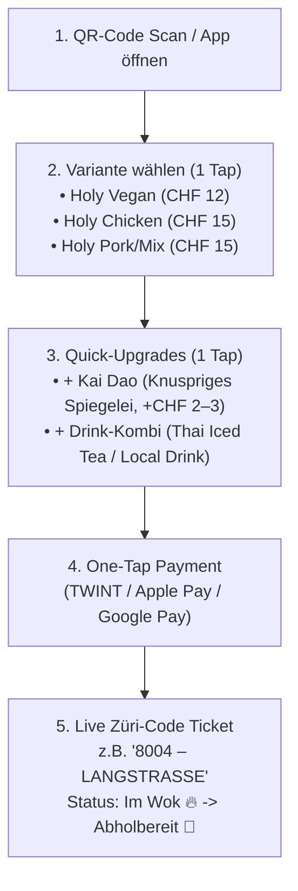
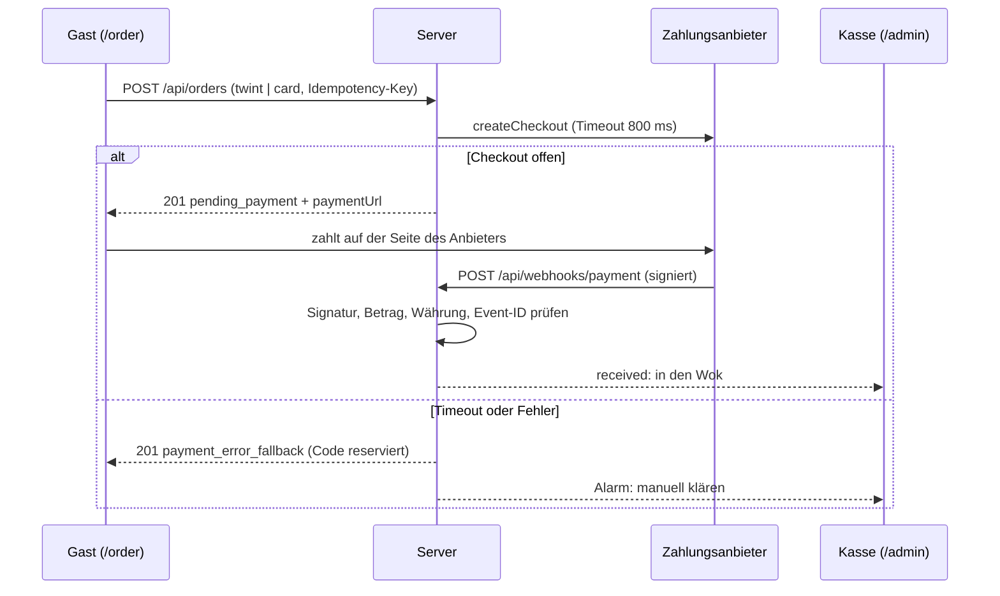

# Holy Basil – Bestell-App, „Züri-Code"-Abholsystem & Tech-Architektur

> **Zweck dieses Dokuments:** Dieses Dokument dient als technische und funktionale Spezifikation (PRD / Agent Blueprint) für die Entwicklung der **Holy Basil Bestell-App**, des **Küchen-Displays (KDS)** am Foodtruck sowie des **„Züri-Code"-Aufrufsystems** (inspiriert vom Flughafen-Code-System bei *yverdis*, adaptiert auf Zürcher Postleitzahlen und Quartiere/Orte).

---

## 1. Kernidee: Warum eine eigene App & das „Züri-Code"-System?

Am Foodtruck, auf Streetfood-Festivals, Weihnachtsmärkten oder bei Pop-up-Stores ist die **Warteschlange der grösste Flaschenhals**. Wenn eine Person gleichzeitig kassieren, Wechselgeld zählen und Bestellungen aufnehmen muss, sinkt der Output im Wok massiv.

Mit der **Holy Basil Web-/Mobile-App (Order & Pickup System)** lösen wir drei Dinge gleichzeitig:
1. **Maximaler Durchsatz (Zero-Queue Ordering):** Gäste scannen am Truck (oder schon auf dem Weg dorthin) einen QR-Code, wählen in unter 20 Sekunden ihr Pad Krapao + Extras und bezahlen direkt digital (TWINT, Apple Pay, Google Pay, Karte).
2. **Das „Züri-Code"-Erlebnis (Statt Kassenbon-Nummer #047):** Analog zu den Flughafencodes bei *yverdis* erhält jede Bestellung eine **Kombination aus 4-stelliger Postleitzahl und Zürcher Quartier/Ortschaft** (z. B. `8004 – Langstrasse`, `8050 – Oerlikon`, `8400 – Winti`).
3. **Kundenbindung & Community-Gamification:** Der Abholcode sorgt für Gespräche vor dem Truck, schafft lokalen Stolz („Rep your Hood" im Hip-Hop-Geist der Marke) und liefert die Basis für Treueprogramme und Quartier-Leaderboards.

---

## 2. Das „Züri-Code"-System im Detail

### Format des Abholcodes
Jeder Code besteht aus zwei Teilen:
- **Primär-Code (Gross & Plakativ):** `4-stellige PLZ` (z. B. `8004`)
- **Sub-Label (Quartier / Stadt / Slang):** Name des Zürcher Kreises, Quartiers oder der Gemeinde im Kanton Zürich (z. B. `LANGSTRASSE` oder `CHREIS CHEIB`)

**Darstellungs-Beispiele für UI & Abhol-Screen:**
- `8001 – NIEDERDORF`
- `8003 – WIEDIKON`
- `8004 – LANGSTRASSE`
- `8005 – ZÜRI WEST`
- `8008 – SEEFELD`
- `8032 – HOTTINGEN`
- `8045 – GIESSHÜBEL`
- `8048 – ALTSTETTEN`
- `8050 – OERLIKON`
- `8057 – MILCHBUCK`
- `8304 – WALLISELLEN`
- `8400 – WINTI`
- `8610 – USTER`
- `8810 – HORGEN`
- `8953 – DIETIKON`

### Vergabe-Logik (Pool & Kollisionsschutz)
Damit es während der Stosszeiten am Foodtruck **niemals zwei aktive Bestellungen mit demselben Code** gibt:
1. **Aktiver Pool:** Das System verwaltet einen Pool von **80 Zürcher Postleitzahlen + Ortsnamen** (`src/lib/zueriCodes.ts`).
2. **Sperre während aktiver Bestellung:** Von der Bestellung bis zur Übergabe (alle Status ausser `completed` und `cancelled`) ist der PLZ-Code für andere Bestellungen gesperrt. Unbezahlte Bestellungen verfallen nach 20 Minuten und geben ihren Code frei.
3. **Freigabe (Cooldown):** Erst 5 Minuten nachdem die Bestellung als `PICKED_UP` markiert wurde, wandert die PLZ zurück in den freien Pool.
4. **Wunsch-PLZ für Stammkunden (Loyalty-Feature):** Eingeloggte Nutzer können ihre „Homebase-PLZ" hinterlegen. Ist diese im Moment frei, bekommt der Gast automatisch seinen eigenen Heimat-Code zugewiesen!

---

## 3. User Flow in der Bestell-App (3-Step Express Checkout)

Das UI folgt strikt dem Design aus [`README_DESIGN.md`](README_DESIGN.md) (Schwarz `#0A0A0A`, zweistufiges Blattgrün `#1B4D2E` / `#52C45A`, Graffiti-Headlines, fette Konturen).

> **Umsetzung (Stand heute):** `/order` ist **ein Screen**. Ziel: Erstkunden bestellen in unter 15 Sekunden mit zwei Taps (Card antippen, Bestellen antippen).
> - **Keine Vorauswahl.** Der Tap auf die Card ist eine bewusste Entscheidung. Ausnahme: ein Link wie `/order?variant=vegan` von der Landingpage.
> - **Fixe Checkout-Leiste mit Deklarations-Modal:** Ein kompakter Trigger in der fixen Leiste zeigt die aktuelle Herkunft / Allergene und öffnet bei Bedarf das vollständige **Deklarations-Modal** (inkl. Allergen-Matrix und Wok-Hinweisen), sodass auf Smartphones der gesamte Bestellbereich sichtbar bleibt. Der Button ist gesperrt, bis eine Variante gewählt ist.
> - **Alles Weitere ist optional und im Fluss:** Kai Dao (1 Tap), Portionen (Stepper), Drinks und Wunsch-Code (aufklappbar). Kein Popup, kein Bottom-Sheet.
> - **Wartezeit** steht vor dem Bestellen oben auf der Seite. Hat die Crew die Annahme pausiert, ist der Button gesperrt.

### Schritt 1: Hauptgericht wählen (Monoprodukt – 3 Cards)
Auf dem Startscreen gibt es kein langes Scrollen, sondern direkt die **3 Hero-Cards** mit dem gut sichtbaren Badge **„100 % vegane Saucen- & Pastenbasis"**. Jede Fleisch-Card zeigt ihre Herkunftszeile:
- **Card 1: HOLY VEGAN** – `CHF 12.00` *(100% Plant-Based)*
- **Card 2: HOLY CHICKEN** – `CHF 15.00`
- **Card 3: HOLY PORK / MIX** – `CHF 15.00` *(Schwein oder Schwein-Rind gemischt)*

### Schritt 2: Upgrades direkt im Screen (kein Bottom-Sheet)
Die Upgrades stehen direkt unter den Cards, mit maximal zwei schnellen Entscheidungen (um den Bestellprozess extrem schnell zu halten und den Durchschnittsbon zu steigern):
1. **Topping-Upgrade:**  
   - `[ ] + Kai Dao (Knuspriges Thai-Spiegelei) (+ CHF 2.50)` *(Bei „Holy Vegan" dezent mit Hinweis „Vegetarisches Extra" versehen)*
2. **Drink-Kombi (Durstlöscher zum Special-Preis):**  
   - `[ ] + Hausgemachter Thai Iced Tea`
   - `[ ] + Kokoswasser / Lokales Zürcher Getränk`

### Schritt 3: Checkout & Live-Status-Screen (Das digitale Abhol-Ticket)
Nach der Zahlung verwandelt sich der Handy-Bildschirm in ein plakativen **Graffiti-Boarding-Pass**:
- Zeigt riesig den zugewiesenen Code: **`8004 – LANGSTRASSE`**
- Zeigt den Live-Status (per Polling alle 3 Sekunden, pausiert bei gesperrtem Handy; WebSockets / Server-Sent Events sind eine spätere Ausbaustufe), die aktuelle Wartezeit und die Deklaration der Bestellung:
  1. `BESTELLUNG EINGEGANGEN` (In der Warteschlange)
  2. `IM WOK 🔥` (Wird gerade frisch gebraten)
  3. `READY TO PICK UP 🔔` (Bildschirm pulsiert in leuchtendem Blattgrün `#52C45A` + Push-/Vibrations-Alert)

---

## 4. Die 3 System-Oberflächen (Architektur für Entwickler-Agenten)

Damit das System im Foodtruck-Alltag reibungslos funktioniert, besteht die Web-App aus drei Ansichten auf derselben Datenbank:

| Ansicht | Route (Vorschlag) | Endgerät | Hauptfunktion |
| :--- | :--- | :--- | :--- |
| **1. Customer Order App** | `/` oder `/order` | Smartphone des Kunden (PWA / Mobile Web ohne App-Store-Zwang) | Menüwahl (3 Varianten + Kai Dao + Drinks), Bezahlung, Live-Abholticket mit Züri-Code. |
| **2. Kitchen Display (KDS)** | `/kitchen` | Tablet im Foodtruck (neben dem Wok) | Zeigt offene Bestellungen gruppiert nach Chargen (z. B. „3x Vegan, 2x Chicken, 4x Kai Dao"). 1-Tap-Button: **`[FERTIG – AUFRUFEN]`**. |
| **3. Public Pickup Board** | `/board` | Monitor / TV-Screen aussen am Foodtruck | Schwarzer Screen im Split-Flap-/Graffiti-Look. Links: **„IM WOK"** (Codes in Vorbereitung). Rechts in leuchtendem Blattgrün: **„ABHOLBEREIT"** (z. B. `8004 – LANGSTRASSE`) inkl. kurzem Hip-Hop-Soundeffekt beim Aufruf. |

---

## 5. Kundenbindung, Gamification & B2B-Modul (Ausbaustufen)

### A. „Rep Your Kreis" – Community & Gamification
- **Quartier-Battle (Leaderboard):** Auf dem Foodtruck-Screen und in der App läuft ein Live-Ranking: *„Welcher Zürcher Kreis hat diesen Monat am meisten Holy Basil gegessen?"* (z. B. Platz 1: `8004`, Platz 2: `8050`, Platz 3: `8003`).
- **Digitaler Stempelpass:** Jede 10. Portion Pad Krapao ist gratis oder schaltet limitierten Holy-Basil-Merch (Sticker-Pack, Shirt im Schwarz-Grün-Graffiti-Design) frei.

### B. B2B- & Event-Preorder-Modus
Für **Phase 2 (Weihnachtsessen, Teamevents, Firmen-Lunches)** kann die App in einen **Event-/B2B-Modus** geschaltet werden:
- Eine Firma bucht den Holy Basil Truck für ein Teamevent (z. B. 80 Mitarbeitende).
- Über einen speziellen Event-Link (`/event/firma-xy`) können alle Mitarbeitenden vorab (oder vor Ort ohne Bezahl-Schritt, da pauschal über B2B abgerechnet) ihre Variante (`Vegan`, `Chicken`, `Pork/Mix` + `Kai Dao`) wählen und erhalten trotzdem ihren persönlichen **Züri-Code** für die Abholung am Truck.
- Zusätzlich direktes Anfrageformular in der App unter `/b2b` für:
  - Foodtruck-Catering & Weihnachtsessen
  - Pop-up-Kooperationen
  - Pad-Krapao-Kochkurse für Teams

---

## 6. Erweiterte Bestell-Logik: Bis zu 10 Portionen, Barzahlung & Schärfe-Toggle

### A. Gruppen- & Einzelbestellungen (1 bis 10 Portionen)
- Kunden können pro Bestellung **1 bis maximal 10 Portionen** wählen.
- Ab 2 Portionen stehen zwei Modi zur Auswahl:
  1. **Express-Modus:** Alle Portionen erhalten dieselbe Konfiguration (ideal für schnelle Team-Bestellungen).
  2. **Individueller Box-Konfigurator:** Jede Box (#1 bis #10) kann separat mit Variante (`Vegan`, `Chicken`, `Pork/Mix`) und `Kai Dao` Spiegelei konfiguriert werden.

### B. Feature Toggle für Schärfegrade (`enableCustomSpiceLevels`)
- **Initialer Start (`false` – Standard):** Um die Wok-Geschwindigkeit beim Start maximal hochzuhalten, werden alle Portionen in der **Holy Basil Standardschärfe (`1 🌶️ · เผ็ดนิดหน่อย`)** zubereitet.
- **Aktiviert (`true`):** Über das Admin-Dashboard (`/admin`) oder die API (`/api/features`) kann die **individuelle Schärfeauswahl pro Portion** freigeschaltet werden:
  - `0` · **ไม่เผ็ด** *(Mai Phet · Nicht scharf)*
  - `1 🌶️` · **เผ็ดนิดหน่อย** *(Phet Nid Noy · Leicht scharf – Hausstandard)*
  - `2 🌶️🌶️` · **เผ็ดมาก** *(Phet Mak · Scharf)*

### B2. Feature Toggle für Extra Protein – „Holy Gains 💪“ (`enableHolyGains`)
- **Initialer Start (`false` – Standard):** Es werden Standard-Portionsgrössen serviert.
- **Aktiviert (`true`):** Kunden können pro Portion für **+ CHF 3.50** Extra Protein hinzubuchen (bei Fleischgerichten extra Schweizer Poulet/Schwein-Rind-Mince, bei *Holy Vegan* extra Bio-Soja- & Pilz-Mince).
- Die Aktivierung wird in `settings.json` persistiert und im Wok-Cockpit (`totalHolyGains`) sowie auf den Schöpfer-Tickets ausgewiesen.

### B3. Nährwert- & Mengenangaben (`NUTRITION_ESTIMATES`)
- Jedes auswählbare Item (Basis-Varianten, *Kai Dao*, *Holy Gains*, Drinks 🍹) hinterlegt in `src/config/features.ts` Schätzwerte für **Gesamtkalorien (kcal), Protein (g), Kohlenhydrate (g) und Fett (g)**.
- Der Bestellkonfigurator und das Abhol-Ticket summieren diese Werte live für die gesamte Bestellung auf und kennzeichnen sie ausdrücklich als **unverbindliche Schätzwerte** (handgemachte Wok-Zubereitung).

### C. Barzahlung (Cash Flow mit `PENDING_CASH`)
- Wählt ein Kunde **Barzahlung am Truck**, erhält die Bestellung sofort einen reservierten Züri-Code im Status `pending_cash`.
- Erst wenn der Kunde an der Foodtruck-Kasse bezahlt und der Kassierer auf `[CHF verbucht · In den Wok freigeben]` tippt, wechselt die Bestellung auf `received` (`paid`) und fliesst in den Wok-Bedarf des Kochs ein.

### D. Digitale Zahlung (`PENDING_PAYMENT`, Details in Kapitel 10)
- Bei TWINT/Karte wartet die Bestellung in `pending_payment`, bis der **signierte Webhook** des Zahlungsanbieters die Zahlung bestätigt. Erst dann wird sie `received`.
- Kann die Zahlung nicht gestartet werden oder schlägt sie fehl, greift `payment_error_fallback`: Der Züri-Code bleibt reserviert, die Kasse klärt manuell.

---

## 7. Der 4-Stationen Foodtruck-Workflow & Wok Demand Management (`/admin`)

1. **Station 1 – Kasse (Cashier):**
   - Bestätigt Barzahlungen (`pending_cash`), offene Online-Zahlungen (`pending_payment`) sowie manuelle Klärungsfälle (`payment_error_fallback`) mit 1 Tap.
   - **Code-Suche:** Ziffernfeld filtert die Liste nach PLZ (Gast sagt «8004», Kasse tippt `80…`).
   - **Rückerstattungen:** Erscheinen als rote Tickets, bis die Kasse sie abhakt (siehe Kapitel 10).
2. **Station 2 – Wok Cockpit (Demand Management für den Koch):**
   - Der Koch muss **nichts abtippen**. Das Display summiert alle bezahlten, noch nicht geschöpften Portionen automatisch in Echtzeit nach Sorte (`HOLY CHICKEN`, `HOLY VEGAN`, `PORK / MIX`) sowie die Gesamtanzahl an `KAI DAO` Spiegeleiern.
   - **Wok-Batches (1 Tap pro Wok-Ladung):** Pro Sorte zeigt das Cockpit «noch zu braten» und «im Wok». `[Batch starten (4)]` nimmt die ältesten wartenden Portionen dieser Sorte (höchstens eine Wok-Ladung, `wokBatchSize`) und markiert sie als gestartet. Die Sorte mit der am längsten wartenden Portion trägt die Marke **«Als Nächstes»**.
   - Der Tap ist freiwillig: Ohne ihn funktioniert der Ablauf wie bisher, nur sieht der Schöpfer dann nicht, was schon gebraten wird.
3. **Station 3 – Schöpfer (Assembly / Plating):**
   - Sieht die exakte Box-Zusammenstellung pro Züri-Code, richtet Duftreis, Krapao und Spiegelei an und schaltet mit 1 Tap weiter an die Qualitätskontrolle (`plating`).
   - Jede Box zeigt «im Wok» oder «wartet». Bestellungen, deren Boxen alle gestartet sind, stehen grün umrandet zuoberst.
4. **Station 4 – Qualitätskontrolle & Drinks (QC & Handout):**
   - Kontrolliert die Boxen, stellt die bestellten Getränke (`Thai Iced Tea`, `Kokoswasser`) bereit und ruft den Züri-Code mit 1 Tap auf (`ready`), wodurch das Kunden-Smartphone und das Public Pickup Board (`/board`) aufleuchten.
   - Aufgerufene Bestellungen, die nach 5 Minuten nicht abgeholt sind, werden rot als «Nicht abgeholt» markiert.

### Stosszeiten (z. B. 40 Bestellungen in 15 Minuten)

- **Ticket-Alter:** Jedes Ticket zeigt, wie lange es an seiner Station wartet (gelb ab 5, rot ab 10 Minuten). Die Zeit kommt vom Server, nicht von der Tablet-Uhr.
- **Taps gehen nie verloren:** Jedes Ticket sperrt nur sich selbst, solange seine Aktion läuft. Andere Tickets bleiben bedienbar.
- **Rückgängig:** Nach «geschöpft», «aufgerufen» und «übergeben» erscheint 8 Sekunden lang ein Rückgängig-Knopf (serverseitig bis 60 Sekunden möglich). Stornieren verlangt eine Bestätigung.
- **Annahme pausieren:** Ein Schalter im Cockpit stoppt neue Gast-Bestellungen (`ordersPaused`). `/order` und `/board` zeigen das an. Die Crew kann weiter Bestellungen erfassen.
- **Wartezeit:** `offene Portionen / wokBatchSize × wokBatchMinutes`, mindestens 3 Minuten. Sichtbar in `/order` vor dem Bestellen, auf dem Ticket, im Cockpit und auf dem Board.
- **Board:** Zeigt so viele Codes, wie ohne Scrollen auf den Bildschirm passen, dazu «+ N weitere». Ein neu aufgerufener Code steht zuoberst, blinkt 20 Sekunden und löst einen Ton aus (einmal pro Bildschirm mit «Ton einschalten» aktivieren).
- **Grenze der Software:** Die Annahme von 4 Portionen pro 2,5 Minuten ergibt rund 24 Portionen in 15 Minuten. 40 Bestellungen sind 60 bis 70 Portionen. Die App macht diese Lücke sichtbar (Wartezeit, Pausieren), schliessen lässt sie sich nur mit mehr Wok-Kapazität.

---

## 8. Non-Functional Requirements (NFRs) & Qualitätsstandards

- **Zahlung (Stand heute):** Nur Barzahlung an der Kasse. TWINT/Karte laufen hinter `DEMO_PAYMENTS=1` über einen **Test-Provider** (es fliesst kein Geld), ein echter Zahlungsanbieter ist noch nicht angebunden. Die Architektur dafür steht (Kapitel 10): Provider-Schnittstelle, signierter Webhook, Idempotency-Keys, `payment_error_fallback` bei Timeouts (> 800 ms) oder Fehlern.
- **Schutz vor Überlastung:** Gäste sind pro Adresse begrenzt (Bestellungen: 30 in 5 Minuten, Formulare: 5 in 10 Minuten). Die Crew ist ausgenommen.
- **Zugriffsschutz:** `/admin` und alle Crew-Routen der API nur mit Crew-PIN (`CREW_PIN`). Gäste sehen nur die eigene Bestellung, das Board nur Code und Status.
- **Latenz-Threshold < 1.000 ms:** Alle API-Endpunkte antworten im Sub-Sekunden-Bereich (Ø < 15 ms) und liefern Echtzeit-Metriken im `meta`-Block.
- **99.5 % API-Verfügbarkeit & RFC-Response-Codes:** Deterministische JSON-Antworten mit HTTP-Statuscodes (`200`, `201`, `400`, `404`, `422`, `401`, `500`) und eindeutiger `correlationId`.
- **> 80 % Testabdeckung:** Automatisierte Unit- und Integrationstests via Vitest (`npm run test:coverage`, aktuell **95.6 % Line & Statement Coverage** über den gesamten Server-Code).

---

## 9. Lebensmittelrecht & Deklaration (LGV / LIV, Kantonales Labor Zürich)

> **Status:** verbindlich für `/order`, Truck-Aushang und Rezepturordner. Alle Texte und Daten leben zentral in `complianceConfig` (`src/config/compliance.ts`). Kein Compliance-Text darf im Frontend hartkodiert werden.
> **Rechtsgrundlagen:** LGV (SR 817.02), LIV (SR 817.022.16) inkl. Anhang 6 (Allergene). Vor Go-Live Artikelverweise gegen die aktuelle Fassung prüfen und durch das Kantonale Labor Zürich gegenlesen lassen.

**Leitprinzip:** Die Pflichtangaben sind *passiv, aber nicht überspringbar*. Es gibt keine Checkbox, keinen Extra-Tap und **kein Popup**. Der schnelle Flow bleibt, weil alles bereits in der fixen Checkout-Leiste über dem Bestellbutton steht.

### 9.1 Schriftliche Fleischherkunft (vor Kaufabschluss)

Pflicht: Die Herkunft jeder Fleischart im Warenkorb steht **schriftlich und vor der Zahlung** sichtbar. Mündliche Auskunft genügt nicht. Bei Fleisch-Mischungen wird **pro Tierart** deklariert.

| Variante | Pflichttext (Template) | Standard |
| :--- | :--- | :--- |
| Holy Chicken | `Fleischherkunft: Poulet: {Land}` | Poulet: Schweiz |
| Holy Pork / Mix | `Fleischherkunft: Schwein: {Land}` und `Fleischherkunft: Rind: {Land}` | Schwein: Schweiz, Rind: Schweiz |
| Holy Vegan | keine Fleischangabe | – |

- **Zusatz bei Hormonen/Leistungsförderern:** Stammt Import-Fleisch (typisch Rind) aus Produktion mit Hormonen oder Leistungsförderern, hängt das System `(mit Hormonen / Leistungsförderern erzeugt)` an. Gesteuert über `growthPromoters: true`.
- **Wechselnde Lieferanten pro Tour-Stopp:** `origin.byStop[stopId]` überschreibt den Standard, optional mit `validFrom` / `validUntil`. Auflösung: Stopp-Override (im Zeitfenster) → Standard → *nicht auflösbar*.
- **Fail closed:** Ist die Herkunft für Stopp und Datum nicht auflösbar, ist die Variante nicht bestellbar, und der Zahlungsbutton wird deaktiviert. Angezeigt wird: «Herkunft für diesen Standort noch nicht erfasst – bitte Crew fragen.»
- **Revisionssicherheit:** Beim Bestellabschluss wird die angezeigte Deklaration (`complianceConfig.version` plus gerenderte Zeilen) als Snapshot an der Bestellung gespeichert.
- **Betrieb:** Vor jedem Tour-Stopp prüft die Crew anhand der Lieferscheine, ob die Herkunft stimmt, und passt bei Abweichung die Config an. Lieferscheine kommen in den Rezepturordner.

#### Pflicht-Sichtbarkeit im UI von `/order`

| # | Ort | Inhalt | Pflicht |
| :-: | :--- | :--- | :--- |
| 1 | **Hero-Card** (Schritt 1) | Kurzzeile unter dem Preis, z. B. `Poulet: Schweiz` | Empfohlen. Die Angabe steht so schon bei der Auswahl. |
| 2 | **Upgrade-Drawer** (Schritt 2) | Bei Kai Dao: `Eier aus Freilandhaltung, Herkunft: Schweiz` | Empfohlen. |
| 3 | **Checkout-Leiste**, **direkt über dem Zahlungsbutton**, ohne Aufklappen | Herkunftszeile(n) je Fleischart im Warenkorb, «Enthält» / «Kann Spuren enthalten» für genau diesen Warenkorb, Eier- und Kreuzkontaminationshinweis. Darunter der aufklappbare Block «Allergene & Zutaten» (inline, kein Modal). | **Zwingend.** Zahlungsbutton nie ohne diesen Block rendern. |
| 4 | **Ticket** `/order/<id>` | Wiederholung der Herkunft und des Snapshots | Zwingend (Nachweis, Zweitzugriff). |

Das gilt für alle Zahlungsarten, auch für «Bestellen & bar zahlen».

### 9.2 Allergen-Management (14 Hauptallergene)

Die 14 Hauptallergene: Gluten (Weizen, Roggen, Gerste, Hafer, Dinkel …), Krebstiere, Eier, Fisch, Erdnüsse, Soja, Milch, Schalenfrüchte, Sellerie, Senf, Sesam, Sulfite, Lupinen, Weichtiere.

**Allergen-Matrix (Soll-Stand, vor Go-Live pro Komponente mit Lieferantenspezifikation bestätigen):**
● = enthalten · ◐ = kann Spuren enthalten / zu prüfen · – = nicht enthalten

| Komponente | Gluten | Eier | Soja | Milch | Sesam | Übrige 10 | Bemerkung |
| :--- | :-: | :-: | :-: | :-: | :-: | :-: | :--- |
| Vegane Krapao-Sauce/Paste | ● (Weizen in Sojasauce) | – | ● | – | ◐ | – | Bei glutenfreiem Tamari Gluten streichen. Sesam nur, wenn im Rezept. |
| Jasmin-Duftreis | – | – | – | – | – | – | |
| Holy Vegan (Soja-/Pilz-Mince) | ◐ (Weizenprotein im Mince) | – | ● | – | – | – | Falls Weizenprotein enthalten ist, zu ● ändern. |
| Holy Chicken (Fleisch) | – | – | – | – | – | – | Allergene nur über Sauce. |
| Holy Pork / Mix (Fleisch) | – | – | – | – | – | – | Allergene nur über Sauce. |
| Kai Dao (Spiegelei) | – | ● | – | – | – | – | |
| Thai Iced Tea (Hafer-Kokos-Creme) | ● (Hafer) | – | – | – | – | – | Kokos ist kein CH-Allergen. |
| Thai Iced Tea (Variante Kondensmilch) | – | – | – | ● | – | – | Dann nicht vegan. |
| Kokoswasser | – | – | – | – | – | – | |
| Züri Mate / Limo | – | – | – | – | – | – | Spezifikation prüfen. |

**Abgeleitete Angaben pro Gericht (inkl. Sauce):**

| Gericht | Enthält | Kann Spuren enthalten (Betrieb) |
| :--- | :--- | :--- |
| Holy Vegan | Soja, Gluten | Gluten (Mince), Sesam, Ei |
| Holy Chicken / Pork-Mix | Soja, Gluten | Sesam, Ei |
| + Kai Dao | zusätzlich Eier | – |

Das System berechnet diese Werte aus den Komponenten (`resolveAllergens`). Wer eine Komponente ändert, ändert automatisch alle betroffenen Gerichte.

**Zulässiger Hinweistext (Offenverkauf, Truck-Aushang und App):**

> **Allergene:** Unsere Saucen und Gerichte können Soja, Gluten (Weizen), Ei und Sesam enthalten. Detaillierte Allergeninformationen finden Sie in der App unter «Allergene» sowie im Rezepturordner am Truck. Unsere Crew gibt gerne Auskunft.

- **Aufklappbarer Block «Allergene & Zutaten» (1 Tap, kein Modal):** Er steht in der Checkout-Leiste direkt über dem Zahlungsbutton und öffnet sich an Ort und Stelle. Der Bestellbutton bleibt dabei sichtbar. Der Block zeigt pro Gericht die Zutaten und alle 14 Allergene mit Status «enthält» oder «kann Spuren enthalten», dazu Stand-Datum (`reviewedAt`) und Version.
- **Rezepturordner am Truck (physisch):** Er enthält pro Rezeptur die Zutatenliste, die Spezifikationsblätter der Zukaufprodukte, die aktuelle Allergen-Matrix und die Lieferscheine der Fleischherkunft. Die Crew kennt den Ordnerstandort und liefert Auskünfte aus dem Ordner, nicht aus dem Gedächtnis.
- **Änderungsprozess:** Neue Zutat oder neuer Lieferant → Config anpassen → `version` und `reviewedAt` erhöhen → Ordner aktualisieren. Wirksam, bevor das Produkt verkauft wird.

### 9.3 Produktionsmethoden & Kreuzkontamination

- **Eier (Kai Dao):** Standardtext `Kai Dao: Eier aus Freilandhaltung, Herkunft: Schweiz` (oder Bodenhaltung). In der Schweiz ist Käfighaltung verboten. Eier aus Haltungsformen, die in der Schweiz nicht erlaubt sind, müssten ausdrücklich deklariert werden (`Eier aus Käfighaltung`). Bei Schweizer Ware entfällt diese Pflichtdeklaration. Die freiwillige Angabe «Freiland/Boden» muss aber stimmen: Beleg über Lieferschein und Lieferantenzertifikat im Ordner. Bei Importeiern oder unbekannter Haltung wechselt der Text automatisch auf den Käfig-Hinweis.
- **Kreuzkontamination im Wok-Betrieb (Standardhinweis im Checkout):** *«Hinweis: Alle Gerichte werden im selben Wok-Betrieb zubereitet. Trotz sorgfältiger Trennung können Spuren von Ei, Soja, Gluten oder Sesam nicht vollständig ausgeschlossen werden.»*
- **Holy Vegan:** *«Holy Vegan wird mit eigenem Wok und Besteck und rein pflanzlichen Saucen zubereitet. Kreuzkontakt mit tierischen Produkten in der Küche kann nicht vollständig ausgeschlossen werden.»* Die Aussage «eigener Wok und Besteck» ist nur zulässig, wenn die Crew das auch einhält (Arbeitsanweisung an Station 2). Die **100 % vegane Saucenbasis** bleibt als Werbeaussage, aber nur für die Basis.
- **Holy Vegan + Kai Dao:** Das Gericht ist **vegetarisch, nicht vegan**. Das UI zeigt «vegetarisch» statt «vegan». Das Ei wird in einer separaten Pfanne zubereitet.

### 9.4 Konfiguration & Tests

- Datenquelle: `complianceConfig` in `src/config/compliance.ts` (Schema siehe Code). Das Frontend rendert ausschliesslich über `buildCheckoutDeclaration()`: Der Server rechnet die Deklaration für jeden Warenkorb, den die Seite bauen kann, vorab aus. Der Browser schlägt die Zeilen nur nach und setzt keinen Deklarationstext selbst zusammen.
- Der Server prüft beim Bestellen erneut (`ORIGIN_NOT_DECLARED`, HTTP 422) und speichert den Snapshot (`declaration`, `stopId`) an der Bestellung. Das Ticket zeigt ihn wieder an.
- Pflicht-Tests (Vitest):
  1. Jedes Menü-Item hat Komponenten, und alle Komponenten existieren.
  2. Alle 14 Allergene haben ein Label.
  3. Fehlt die Herkunft für Stopp und Datum, ist `blocked === true`.
  4. Ein Stopp-Override gilt nur im Zeitfenster.
  5. Kai Dao plus Käfig/unbekannt erzeugt den Käfig-Hinweis.
  6. Vegan plus Kai Dao zeigt den Vegetarisch-Hinweis.
  7. Release-Gate: Solange eine Komponente `verified: false` ist, schlägt der Produktions-Build/Start-Check mit einer Warnung an.

Alle sieben Tests stehen in `tests/unit/compliance.test.ts`. Stand heute sind alle Komponenten `verified: false` (Soll-Stand ohne Lieferantenspezifikation): Der Server warnt bei jedem Start.

---

## 10. Go-Live-Bausteine: Zahlung, Newsletter, Rechtsseiten

> **Status:** Architektur und Code stehen und sind getestet. Zahlung und E-Mail laufen gegen einen Test-Provider bzw. einen Mock. Die echten Anbieter und die Rechtstexte folgen.

### 10.1 Zahlungsanbindung (`src/lib/paymentService.ts`)

- **Schnittstelle `PaymentProvider`:** `createCheckout()` und `verifyWebhook()`. Heute gibt es nur den Test-Provider (aktiv mit `DEMO_PAYMENTS=1`, Zahlseite `/pay/test/<ref>`). Ein echter Anbieter (z. B. Stripe Checkout mit TWINT, Payrexx, Datatrans) implementiert dieselbe Schnittstelle und wird in `getPaymentProvider()` zurückgegeben.
- **Nur der Webhook macht eine Bestellung bezahlt**, nie der Browser, der von der Zahlseite zurückkommt.
- **Signatur über den Rohtext:** HMAC-SHA256 über `<Zeitstempel>.<Body>`, Header `x-hb-signature: t=…,v1=…`, Vergleich in konstanter Zeit, höchstens 5 Minuten alt. Geheimnis: `PAYMENT_WEBHOOK_SECRET`.
- **Idempotenz:** Verarbeitete Event-IDs liegen in `data/payment-events.json` und überleben einen Neustart. Derselbe Idempotency-Key erzeugt nie eine zweite Bestellung.
- **Beträge in Rappen** (Ganzzahl). Weicht Betrag oder Währung ab, wird die Bestellung nicht freigegeben.

| Ereignis | Zustand der Bestellung | Ergebnis |
| :--- | :--- | :--- |
| `payment.succeeded` | `pending_payment` oder `payment_error_fallback` | bezahlt, `received` |
| `payment.succeeded` | Betrag/Währung falsch | `payment_error_fallback` + Rückerstattung `AMOUNT_MISMATCH` |
| `payment.succeeded` | storniert (z. B. nach 20 Minuten verfallen) | Rückerstattung `PAID_AFTER_CANCEL` |
| `payment.succeeded` | von der Kasse schon bar kassiert | Rückerstattung `DOUBLE_PAYMENT`, Essen wird trotzdem gemacht |
| `payment.failed` / `payment.expired` | `pending_payment` | `payment_error_fallback`, Code bleibt reserviert |
| Checkout-Timeout (> 800 ms) oder Anbieter-Fehler | neu | `payment_error_fallback` |
| gleiches Event nochmals | beliebig | ignoriert (`DUPLICATE_EVENT`) |
| Event zu unbekannter Bestellung | – | 200 quittiert, im Log vermerkt |

- **Bezahlte Bestellungen verfallen nie.** Nur unbezahlte (`pending_cash`, `pending_payment`, `payment_error_fallback`) werden nach 20 Minuten storniert.
- **Rückerstattungen** (`refundDue`) stehen als rotes Ticket an der Kasse, bis jemand «zurückerstattet» tippt. Die Rückzahlung selbst erfolgt heute von Hand im Portal des Anbieters.

**Offen für die echte Anbindung:** Adapter für den gewählten Anbieter, dessen Signaturschema, `PUBLIC_BASE_URL` für die Rücksprung-Adresse, automatische Rückerstattung über die Anbieter-API.

### 10.2 Tour-Newsletter mit Double-Opt-in (`src/lib/newsletter.ts`)

1. `POST /api/newsletter` speichert die Adresse als `pending` und schickt eine E-Mail mit Bestätigungslink. Die Antwort ist immer dieselbe (`202 confirmation_sent`), egal ob die Adresse neu, offen oder schon bestätigt ist.
2. `/newsletter/confirm?token=…` zeigt eine Seite mit einem Knopf. Erst der Tap (`POST /api/newsletter/confirm`) bestätigt. So bestätigt kein Mail-Scanner, der Links vorab öffnet.
3. Der Link gilt 48 Stunden und einmal. Gespeichert wird nur der SHA-256 des Tokens. Unbestätigte Einträge werden nach 48 Stunden gelöscht.
4. Jede E-Mail enthält einen Abmeldelink (`/newsletter/unsubscribe`). Abmelden löscht den Eintrag.
5. **Nachweis der Einwilligung:** Einwilligungstext samt Version (`NEWSLETTER_CONSENT` in `src/config/legal.ts`), Zeitpunkt der Anmeldung, Zeitpunkt der Bestätigung.

**Versand heute:** Mock (`src/lib/mailer.ts`). Es wird nichts verschickt. Jede Nachricht landet in `data/outbox.json` und in der Server-Konsole, damit sich der Ablauf lokal durchspielen lässt. **Offen:** ein `Mailer` für den echten Anbieter (z. B. Brevo oder SMTP).

### 10.3 Impressum und Datenschutz (`/impressum`, `/datenschutz`)

- Stammdaten in `src/config/legal.ts`. Werte in `[ECKIGEN KLAMMERN]` sind **Platzhalter**. Solange welche offen sind, zeigen beide Seiten einen Entwurfs-Hinweis und der Server warnt beim Start.
- Die Texte sind ein **Entwurf zur anwaltlichen Prüfung**, keine Rechtsberatung.
- Alle Seiten verlinken Impressum und Datenschutz. Schriften liegen auf dem eigenen Server (`/fonts/*`): Keine Seite lädt etwas von Dritten.
- Bestellungen brauchen keine Personendaten (kein Name, keine E-Mail, kein Konto).