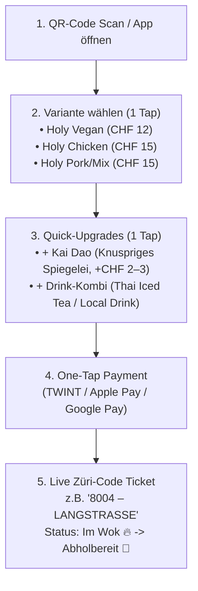

# Holy Basil – Bestell-App, „Züri-Code"-Abholsystem & Tech-Architektur

> **Zweck dieses Dokuments:** Dieses Dokument dient als technische und funktionale Spezifikation (PRD / Agent Blueprint) für die Entwicklung der **Holy Basil Bestell-App**, des **Küchen-Displays (KDS)** am Foodtruck sowie des **„Züri-Code"-Aufrufsystems** (inspiriert vom Flughafen-Code-System bei *yverdis*, adaptiert auf Zürcher Postleitzahlen und Quartiere/Orte).

---

## 1. Kernidee: Warum eine eigene App & das „Züri-Code"-System?

Am Foodtruck, auf Streetfood-Festivals, Weihnachtsmärkten oder bei Pop-up-Stores ist die **Warteschlange der grösste Flaschenhals**. Wenn eine Person gleichzeitig kassieren, Wechselgeld zählen und Bestellungen aufnehmen muss, sinkt der Output im Wok massiv.

Mit der **Holy Basil Web-/Mobile-App (Order & Pickup System)** lösen wir drei Dinge gleichzeitig:
1. **Maximaler Durchsatz (Zero-Queue Ordering):** Gäste scannen am Truck (oder schon auf dem Weg dorthin) einen QR-Code, wählen in unter 20 Sekunden ihr Pad Krapao + Extras und bezahlen direkt digital (TWINT, Apple Pay, Google Pay, Karte).
2. **Das „Züri-Code"-Erlebnis (Statt Kassenbon-Nummer #047):** Analog zu den Flughafencodes bei *yverdis* erhält jede Bestellung eine **Kombination aus 4-stelliger Postleitzahl und Zürcher Quartier/Ortschaft** (z. B. `8004 – Langstrasse`, `8050 – Oerlikon`, `8400 – Winti`).
3. **Kundenbindung & Community-Gamification:** Der Abholcode sorgt für Gespräche vor dem Truck, schafft lokalen Stolz („Rep your Hood" im Hip-Hop-Geist der Marke) und liefert die Basis für Treueprogramme und Quartier-Leaderboards.

---

## 2. Das „Züri-Code"-System im Detail

### Format des Abholcodes
Jeder Code besteht aus zwei Teilen:
- **Primär-Code (Gross & Plakativ):** `4-stellige PLZ` (z. B. `8004`)
- **Sub-Label (Quartier / Stadt / Slang):** Name des Zürcher Kreises, Quartiers oder der Gemeinde im Kanton Zürich (z. B. `LANGSTRASSE` oder `CHREIS CHEIB`)

**Darstellungs-Beispiele für UI & Abhol-Screen:**
- `8001 – NIEDERDORF`
- `8003 – WIEDIKON`
- `8004 – LANGSTRASSE`
- `8005 – ZÜRI WEST`
- `8008 – SEEFELD`
- `8032 – HOTTINGEN`
- `8045 – GIESSHÜBEL`
- `8048 – ALTSTETTEN`
- `8050 – OERLIKON`
- `8057 – MILCHBUCK`
- `8304 – WALLISELLEN`
- `8400 – WINTI`
- `8610 – USTER`
- `8810 – HORGEN`
- `8953 – DIETIKON`

### Vergabe-Logik (Pool & Kollisionsschutz)
Damit es während der Stosszeiten am Foodtruck **niemals zwei aktive Bestellungen mit demselben Code** gibt:
1. **Aktiver Pool:** Das System verwaltet einen Pool von ca. **60–80 bekannten Zürcher Postleitzahlen + Ortsnamen**.
2. **Sperre während aktiver Bestellung:** Solange eine Bestellung den Status `RECEIVED`, `IN_WOK` oder `READY_FOR_PICKUP` hat, ist dieser PLZ-Code für andere neue Bestellungen gesperrt.
3. **Freigabe (Cooldown):** Erst 5 Minuten nachdem die Bestellung als `PICKED_UP` markiert wurde, wandert die PLZ zurück in den freien Pool.
4. **Wunsch-PLZ für Stammkunden (Loyalty-Feature):** Eingeloggte Nutzer können ihre „Homebase-PLZ" hinterlegen. Ist diese im Moment frei, bekommt der Gast automatisch seinen eigenen Heimat-Code zugewiesen!

---

## 3. User Flow in der Bestell-App (3-Step Express Checkout)

Das UI folgt strikt dem Design aus [`README_DESIGN.md`](README_DESIGN.md) (Schwarz `#0A0A0A`, zweistufiges Blattgrün `#1B4D2E` / `#52C45A`, Graffiti-Headlines, fette Konturen).

### Schritt 1: Hauptgericht wählen (Monoprodukt – 3 Cards)
Auf dem Startscreen gibt es kein langes Scrollen, sondern direkt die **3 Hero-Cards** mit dem gut sichtbaren Badge **„100% Vegane Saucen- & Pastenbasis"**:
- **Card 1: HOLY VEGAN** – `CHF 12.00` *(100% Plant-Based)*
- **Card 2: HOLY CHICKEN** – `CHF 15.00`
- **Card 3: HOLY PORK / MIX** – `CHF 15.00` *(Schwein oder Schwein-Rind gemischt)*

### Schritt 2: Das „No-Friction" Upgrade-Drawer (Bottom Sheet)
Sobald eine Variante angetippt wird, öffnet sich ein kurzes Bottom-Sheet mit maximal zwei schnellen Entscheidungen (um den Bestellprozess extrem schnell zu halten und den Durchschnittsbon zu steigern):
1. **Topping-Upgrade:**  
   - `[ ] + Kai Dao (Knuspriges Thai-Spiegelei) (+ CHF 2.50)` *(Bei „Holy Vegan" dezent mit Hinweis „Vegetarisches Extra" versehen)*
2. **Drink-Kombi (Durstlöscher zum Special-Preis):**  
   - `[ ] + Hausgemachter Thai Iced Tea`
   - `[ ] + Kokoswasser / Lokales Zürcher Getränk`

### Schritt 3: Checkout & Live-Status-Screen (Das digitale Abhol-Ticket)
Nach der Zahlung verwandelt sich der Handy-Bildschirm in ein plakativen **Graffiti-Boarding-Pass**:
- Zeigt riesig den zugewiesenen Code: **`8004 – LANGSTRASSE`**
- Zeigt den Live-Status (aktuell per Polling alle 2 Sekunden; WebSockets / Server-Sent Events sind eine spätere Ausbaustufe):
  1. `BESTELLUNG EINGEGANGEN` (In der Warteschlange)
  2. `IM WOK 🔥` (Wird gerade frisch gebraten)
  3. `READY TO PICK UP 🔔` (Bildschirm pulsiert in leuchtendem Blattgrün `#52C45A` + Push-/Vibrations-Alert)

---

## 4. Die 3 System-Oberflächen (Architektur für Entwickler-Agenten)

Damit das System im Foodtruck-Alltag reibungslos funktioniert, besteht die Web-App aus drei Ansichten auf derselben Datenbank:

| Ansicht | Route (Vorschlag) | Endgerät | Hauptfunktion |
| :--- | :--- | :--- | :--- |
| **1. Customer Order App** | `/` oder `/order` | Smartphone des Kunden (PWA / Mobile Web ohne App-Store-Zwang) | Menüwahl (3 Varianten + Kai Dao + Drinks), Bezahlung, Live-Abholticket mit Züri-Code. |
| **2. Kitchen Display (KDS)** | `/kitchen` | Tablet im Foodtruck (neben dem Wok) | Zeigt offene Bestellungen gruppiert nach Chargen (z. B. „3x Vegan, 2x Chicken, 4x Kai Dao"). 1-Tap-Button: **`[FERTIG – AUFRUFEN]`**. |
| **3. Public Pickup Board** | `/board` | Monitor / TV-Screen aussen am Foodtruck | Schwarzer Screen im Split-Flap-/Graffiti-Look. Links: **„IM WOK"** (Codes in Vorbereitung). Rechts in leuchtendem Blattgrün: **„ABHOLBEREIT"** (z. B. `8004 – LANGSTRASSE`) inkl. kurzem Hip-Hop-Soundeffekt beim Aufruf. |

---

## 5. Kundenbindung, Gamification & B2B-Modul (Ausbaustufen)

### A. „Rep Your Kreis" – Community & Gamification
- **Quartier-Battle (Leaderboard):** Auf dem Foodtruck-Screen und in der App läuft ein Live-Ranking: *„Welcher Zürcher Kreis hat diesen Monat am meisten Holy Basil gegessen?"* (z. B. Platz 1: `8004`, Platz 2: `8050`, Platz 3: `8003`).
- **Digitaler Stempelpass:** Jede 10. Portion Pad Krapao ist gratis oder schaltet limitierten Holy-Basil-Merch (Sticker-Pack, Shirt im Schwarz-Grün-Graffiti-Design) frei.

### B. B2B- & Event-Preorder-Modus
Für **Phase 2 (Weihnachtsessen, Teamevents, Firmen-Lunches)** kann die App in einen **Event-/B2B-Modus** geschaltet werden:
- Eine Firma bucht den Holy Basil Truck für ein Teamevent (z. B. 80 Mitarbeitende).
- Über einen speziellen Event-Link (`/event/firma-xy`) können alle Mitarbeitenden vorab (oder vor Ort ohne Bezahl-Schritt, da pauschal über B2B abgerechnet) ihre Variante (`Vegan`, `Chicken`, `Pork/Mix` + `Kai Dao`) wählen und erhalten trotzdem ihren persönlichen **Züri-Code** für die Abholung am Truck.
- Zusätzlich direktes Anfrageformular in der App unter `/b2b` für:
  - Foodtruck-Catering & Weihnachtsessen
  - Pop-up-Kooperationen
  - Pad-Krapao-Kochkurse für Teams

---

## 6. Erweiterte Bestell-Logik: Bis zu 10 Portionen, Barzahlung & Schärfe-Toggle

### A. Gruppen- & Einzelbestellungen (1 bis 10 Portionen)
- Kunden können pro Bestellung **1 bis maximal 10 Portionen** wählen.
- Ab 2 Portionen stehen zwei Modi zur Auswahl:
  1. **Express-Modus:** Alle Portionen erhalten dieselbe Konfiguration (ideal für schnelle Team-Bestellungen).
  2. **Individueller Box-Konfigurator:** Jede Box (#1 bis #10) kann separat mit Variante (`Vegan`, `Chicken`, `Pork/Mix`) und `Kai Dao` Spiegelei konfiguriert werden.

### B. Feature Toggle für Schärfegrade (`enableCustomSpiceLevels`)
- **Initialer Start (`false` – Standard):** Um die Wok-Geschwindigkeit beim Start maximal hochzuhalten, werden alle Portionen in der **Holy Basil Standardschärfe („Leicht scharf 🌶️")** zubereitet.
- **Aktiviert (`true`):** Über das Admin-Dashboard (`/admin`) oder die API (`/api/features`) kann die individuelle Schärfeauswahl (`Mild`, `Leicht scharf`, `Original Thai Spicy 🔥`, `Bangkok Extra Hot 🔥🔥🔥`) jederzeit per 1-Klick freigeschaltet werden.

### C. Barzahlung (Cash Flow mit `PENDING_CASH`)
- Wählt ein Kunde **Barzahlung am Truck**, erhält die Bestellung sofort einen reservierten Züri-Code im Status `pending_cash`.
- Erst wenn der Kunde an der Foodtruck-Kasse bezahlt und der Kassierer auf `[CHF verbucht · In den Wok freigeben]` tippt, wechselt die Bestellung auf `received` (`paid`) und fliesst in den Wok-Bedarf des Kochs ein.

---

## 7. Der 4-Stationen Foodtruck-Workflow & Wok Demand Management (`/admin`)

1. **Station 1 – Kasse (Cashier):**
   - Bestätigt Barzahlungen (`pending_cash`) sowie manuelle Klärungsfälle (`payment_error_fallback`) mit 1 Tap.
2. **Station 2 – Wok Cockpit (Zero-Click Demand Management für den Koch):**
   - Der Koch muss **nichts abtippen**. Das Display summiert alle bezahlten, noch nicht geschöpften Portionen automatisch in Echtzeit nach Sorte (`HOLY CHICKEN`, `HOLY VEGAN`, `PORK / MIX`) sowie die Gesamtanzahl an `KAI DAO` Spiegeleiern.
3. **Station 3 – Schöpfer (Assembly / Plating):**
   - Sieht die exakte Box-Zusammenstellung pro Züri-Code, richtet Duftreis, Krapao und Spiegelei an und schaltet mit 1 Tap weiter an die Qualitätskontrolle (`plating`).
4. **Station 4 – Qualitätskontrolle & Drinks (QC & Handout):**
   - Kontrolliert die Boxen, stellt die bestellten Getränke (`Thai Iced Tea`, `Kokoswasser`) bereit und ruft den Züri-Code mit 1 Tap auf (`ready`), wodurch das Kunden-Smartphone und das Public Pickup Board (`/board`) aufleuchten.

---

## 8. Non-Functional Requirements (NFRs) & Qualitätsstandards

- **Zahlung (Stand heute):** Nur Barzahlung an der Kasse. TWINT/Karte sind eine Simulation hinter `DEMO_PAYMENTS=1`, ein Zahlungsanbieter ist noch nicht angebunden. Ziel für die echte Anbindung: Idempotency-Keys gegen Doppelbelastungen; bei Timeouts (> 800 ms) oder Gateway-Fehlern greift der Status `payment_error_fallback`, der den Züri-Code schützt und die Kasse zur manuellen Klärung alarmiert.
- **Zugriffsschutz:** `/admin` und alle Crew-Routen der API nur mit Crew-PIN (`CREW_PIN`). Gäste sehen nur die eigene Bestellung, das Board nur Code und Status.
- **Latenz-Threshold < 1.000 ms:** Alle API-Endpunkte antworten im Sub-Sekunden-Bereich (Ø < 15 ms) und liefern Echtzeit-Metriken im `meta`-Block.
- **99.5 % API-Verfügbarkeit & RFC-Response-Codes:** Deterministische JSON-Antworten mit HTTP-Statuscodes (`200`, `201`, `400`, `404`, `422`, `401`, `500`) und eindeutiger `correlationId`.
- **> 80 % Testabdeckung:** Automatisierte Unit- und Integrationstests via Vitest (`npm run test:coverage`, aktuell **93.6 % Line & Statement Coverage** über den gesamten Server-Code).

