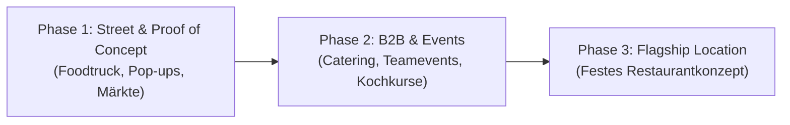

# Holy Basil – Strategische Ausrichtung, Konzept & Werte

> **Zweck dieses Dokuments:** Dieses Dokument definiert die geschäftliche Vision, die Markenwerte, die Produkt- und Preisstrategie sowie die mehrstufige Wachstums-Roadmap von **Holy Basil** im Schweizer Markt (Fokus: Grossraum Zürich).

---

## 1. Vision & Mission

**Die Idee:** In Thailand ist *Pad Krapao* (Stir-Fried Holy Basil) das unangefochtene National-Streetfood – schnell, intensiv, aromatisch und zu jeder Tageszeit geliebt. In der Schweiz hingegen ist authentisches Pad Krapao oft nur als teures Restaurantgericht unter fünfzig anderen Menüpunkten zu finden – meist angepasst und ohne Fokus.

**Unsere Mission:**  
Wir machen **Pad Krapao** zum neuen Streetfood-Standard in Zürich. Wir konzentrieren uns zu **100 % auf ein einziges Gericht (Monoprodukt-Strategie)**, perfektionieren es geschmacklich wie operativ und bieten es zu einem für Schweizer Verhältnisse unschlagbar fairen Preis (**12 bis 15 CHF**) an.

---

## 2. Unsere Kernwerte (Core Values)

1. **Radikaler Fokus (One Dish Mastery):**  
   Wir machen keine Frühlingsrollen, kein Pad Thai und kein grünes Curry. Wir machen **nur Pad Krapao**. Dadurch garantieren wir höchste Frische, extrem schnelle Zubereitungszeiten im Wok und gleichbleibende Spitzenqualität.
2. **Preis-Revolution & Zugänglichkeit (Fair Street Pricing):**  
   Streetfood in Zürich kostet heute oft 18 bis 25 CHF. Unser Ziel ist ein Preisband von **12 bis 15 CHF**. Gutes, frisches Essen soll kein Luxusgut sein, sondern für Studierende, Bürolisten und Nachtschwärmer gleichermassen erschwinglich bleiben.
3. **Inklusivität ab der Basis (100 % Vegane Saucen- & Pasten-Architektur):**  
   Traditionelles Pad Krapao nutzt oft Fisch- und Austernsauce. Bei **Holy Basil** sind **sämtliche Grundsaucen und Gewürzpasten zu 100 % vegan** entwickelt – ohne Kompromisse beim tiefen Umami-Geschmack. Ob jemand die vegane Variante oder Fleisch wählt: Die Basis ist für alle rein pflanzlich, transparent und frei von versteckten tierischen Zusätzen.
4. **Urban Culture & Lokale Verbundenheit:**  
   Wir verbinden die Energie Bangkoker Strassenküchen mit Hip-Hop-Kultur und starkem Zürcher Lokalbezug (sichtbar bis in unser Bestell- und Aufrufsystem mit Zürcher Postleitzahlen und Orten).

---

## 3. Das Produkt- & Preismodell

### Die 3 Varianten (Monoprodukt in 3 Ausprägungen)
Jede Portion wird frisch mit Duftreis (Jasminreis), unserer geheimen **100 % veganen Krapao-Sauce/Paste**, frischem Chilis, Knoblauch und reichlich Holy Basil zubereitet:

| Variante | Beschreibung | Zielpreis (CHF) | Positionierung |
| :--- | :--- | :--- | :--- |
| **1. Holy Vegan** | Pflanzliche Basis (z. B. knusprig gebratener Tofu / Soja-Mince / Pilz-Textur) mit voller Krapao-Würze | **CHF 12.–** | Einstiegspreis-Knaller, 100 % vegan, hohe Marge, volle Würze |
| **2. Holy Chicken** | Fein gehacktes / geschnittenes Pouletfleisch aus dem heissen Wok | **CHF 14.– bis 15.–** | Der Bestseller-Klassiker aus Bangkok |
| **3. Holy Pork / Mixed** | Gehacktes Schweinefleisch oder kräftiger **Schwein-Rind-Mix** für maximales Aroma | **CHF 14.– bis 15.–** | Deftige Streetfood-Variante für Fleischliebhaber |

###Gezielte Upselling-Extras (Für höheren Durchschnittsbon bei vollem Küchen-Speed)
Um die Wok-Geschwindigkeit nicht durch komplizierte Sonderwünsche auszubremsen, gibt es im Bestellprozess bewusst nur **zwei schnelle, margenstarke Upgrades**:
1. **Klassisches Thai-Upgrade – „Kai Dao" (+ CHF 2.– bis 3.–):** Ein knusprig im Wok ausgebackenes Spiegelei mit flüssigem Eigelb – das ultimative Original-Topping zu Pad Krapao.
2. **Getränke-Kombis (Drink Bundles):** Passende Durstlöscher gegen die Krapao-Würze (z. B. hausgemachter *Thai Iced Tea*, Kokoswasser oder lokale Zürcher Kult-Drinks/Bier) als 1-Click-Kombi in der App.

### Warum funktioniert der Preis von 12–15 CHF in Zürich?
- **Einkaufsvorteil durch Monoprodukt:** Nur wenige Zutaten in grossen Mengen nötig.
- **Einheitliche Saucen- & Pastenbasis:** Da die gesamte Paste und Sauce vegan vorproduziert wird, fällt doppelte Lagerhaltung und Verwechslungsgefahr am Grill/Wok komplett weg.
- **Minimaler Foodwaste:** Durch nur 3 Protein-Optionen und eine gemeinsame Reis-/Saucen-Basis lässt sich der Wareneinsatz präzise kalkulieren.
- **Hoher Durchsatz (High Volume):** Kurze Wok-Zeiten + App-Vorbestellung = mehr Portionen pro Stunde in der kurzen Mittags- oder Festival-Spitze.

---

## 4. Kundenbindung & Das „Züri-Code"-Bestellsystem

Inspiriert vom Abholkonzept von *yverdis* (wo Kunden statt einer langweiligen Kassenbon-Nummer einen dreistelligen Flughafencode wie `ZRH` oder `BKK` erhalten), setzen wir bei **Holy Basil** auf **lokale Identifikation über eine eigene Bestell-App**:

- **So funktioniert es:** Sobald ein Gast über die App (oder am Terminal) bestellt, wird seiner Bestellung eine **Zürcher Postleitzahl oder eine Zürcher Ortschaft / ein Kreis** zugewiesen (z. B. `8004 – Chreis Cheib`, `8001 – Niederdorf`, `8050 – Oerlikon`, `8400 – Winti`, `8610 – Uster`).
- **Der Effekt am Foodtruck / Pop-up:**  
  Statt „Nummer 47!" ruft die Crew (oder zeigt das Display im Graffiti-Split-Flap-Look): **„Einmal Holy Chicken für 8004!"** oder **„Oerlikon ist ready!"**
- **Mehrwert:**  
  - Sofortiger Gesprächsstoff in der Warteschlange („Ah, bisch au us 8004?").
  - Gamification-Potenzial in der App (z. B. Kunden können ihre echte Lieblings-PLZ als Stamm-Tag hinterlegen oder „Welcher Zürcher Kreis isst am schärfsten?"-Leaderboards).

---

## 5. Rollout- & Wachstumsstrategie (3 Phasen)

### Phase 1: Klein starten, Marke testen & Hype aufbauen (B2C Streetfood)
- **Kanäle:** 
  - Mobiler **Foodtruck** oder schlanke **Pop-up-Stores** im Raum Zürich.
  - **Streetfood-Festivals**, Quartiermärkte, Wochenmärkte und **Weihnachtsmärkte** (heisses, würziges Pad Krapao funktioniert im Winter auf Weihnachtsmärkten hervorragend als Alternative zu Raclette und Bratwurst!).
- **Ziel:** Geringes Fixkosten-Risiko, direktes Kundenfeedback zu Schärfe und Rezeptur, organisches Marketing über den markanten Schwarz-Grün-Graffiti-Auftritt und die Bestell-App.

### Phase 2: B2B-Expansion & Erlebnis-Angebote
Sobald Marke und Prozesse stehen, wird das Geschäft durch planbare B2B-Umsätze stabilisiert:
- **Firmen-Catering & Weihnachtsessen:** Der Foodtruck oder eine mobile Wok-Station kommt direkt zu Unternehmen (Mittags-Special, Sommerfest oder alternatives Weihnachtsessen). Da die Basis 100 % vegan ist und es sowohl vegane als auch Fleisch-Optionen gibt, wird jede Ernährungsgruppe im Team glücklich.
- **Teamevents & Kochkurse:** Interaktive „Pad Krapao & Thai Streetfood"-Workshops für Firmen oder private Gruppen (Wie stellt man die vegane Krapao-Paste her? Wok-Technik, Geschichte von Holy Basil).

### Phase 3: Stationäres Restaurantkonzept
- Übergang von Pop-up und Truck zu einem festen, kompakten Standort an einer hochfrequentierten Lage in Zürich (Take-away + unkomplizierte Bar-/Streetfood-Sitzplätze, Hip-Hop-Soundtrack, App-Pick-up-Wall).
